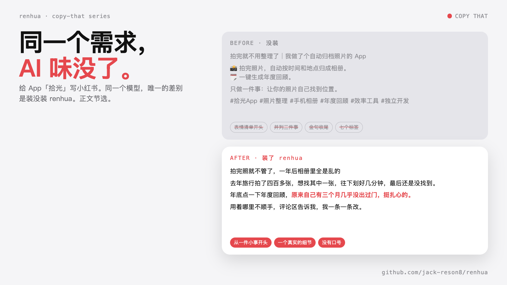
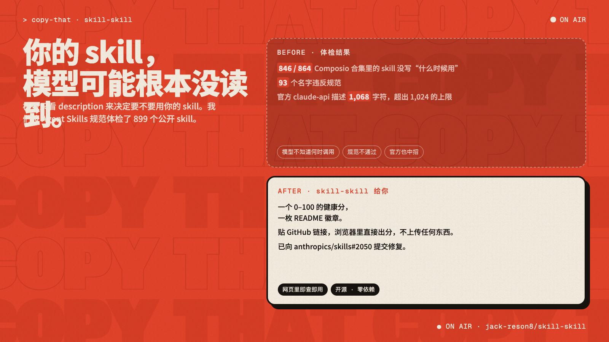
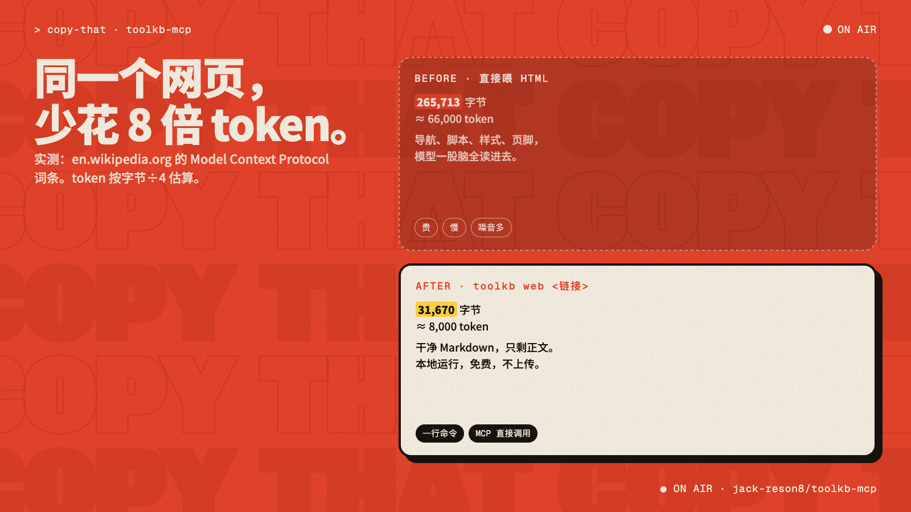
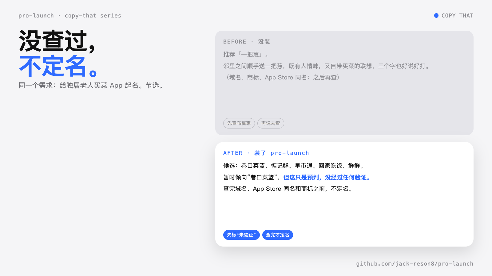
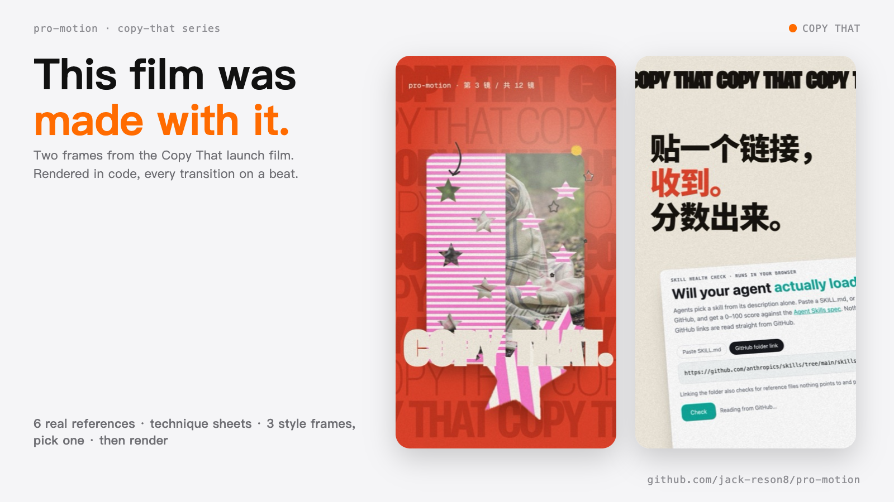

# Copy That

English | [简体中文](README.zh-CN.md)

**You say what you want made. Your agent says "copy that" and makes it with taste.**

Six open-source tools for people who make and ship things, for Claude Code and Codex. MIT, free.

## Install all of them

**Claude Code**
```
/plugin marketplace add jack-reson8/copy-that
/plugin install pro-motion@copy-that
```
Swap in any name from the table. Each plugin installs from its own repo.

**Codex**
```bash
codex plugin marketplace add https://github.com/jack-reson8/copy-that.git
codex plugin add pro-motion@copy-that
```

## The set

| | Skill | What you get |
|---|---|---|
| <a href="https://github.com/jack-reson8/pro-motion"></a> | **[Pro Motion](https://github.com/jack-reson8/pro-motion)** | Launch films and brand films rendered in code, every cut on a beat. |
| <a href="https://github.com/jack-reson8/pro-launch"></a> | **[pro-launch](https://github.com/jack-reson8/pro-launch)** | Take an app from idea to shipped, taste first: naming, references, style frames, launch. |
| <a href="https://github.com/jack-reson8/renhua"></a> | **[人话 renhua](https://github.com/jack-reson8/renhua)** | Chinese posts and copy that sound like a person, not a model. |
| <a href="https://github.com/jack-reson8/post-skill"></a> | **[Post](https://github.com/jack-reson8/post-skill)** | Share-image sets that look like real app screens and read like a person. |
| <a href="https://github.com/jack-reson8/skill-skill"></a> | **[skill-skill](https://github.com/jack-reson8/skill-skill)** | Write, audit and publish skills that actually change what gets generated. |
| <a href="https://github.com/jack-reson8/toolkb-mcp"></a> | **[toolkb-mcp](https://github.com/jack-reson8/toolkb-mcp)** | An MCP server: any link to clean Markdown, local and free. Install from its repo. |

**Check your own skill:** paste a GitHub link into the [skill health checker](https://jack-reson8.github.io/skill-skill/check/) and get a 0–100 score and a README badge. Runs in your browser, nothing uploaded.

## See the difference

Same request, same model. Left is without the skill, right is with it. Numbers are measured, outputs are real runs (excerpts).












## FAQ

**What is a Claude skill?** A folder with a SKILL.md. The model reads its description, decides whether to load it, then follows it. If the description doesn't say when to use it, it never loads.

**Which one should I install first?** Writing Chinese posts: renhua. Making a launch video: Pro Motion. Building an app: pro-launch. Share images: Post. Pages to Markdown: toolkb-mcp. Writing your own skill: skill-skill.

**Does it work in Codex?** Yes, see the install block above. Tested in both.

**Is it free?** MIT licensed, no accounts, nothing uploaded.

## Why "Copy That"

Copy is the writing in an ad. "Copy that" is what you say when you got the brief and you're on it. And copy is what you do to start using these. All three are true here.

MIT licensed. Made by [jack-reson8](https://github.com/jack-reson8).
